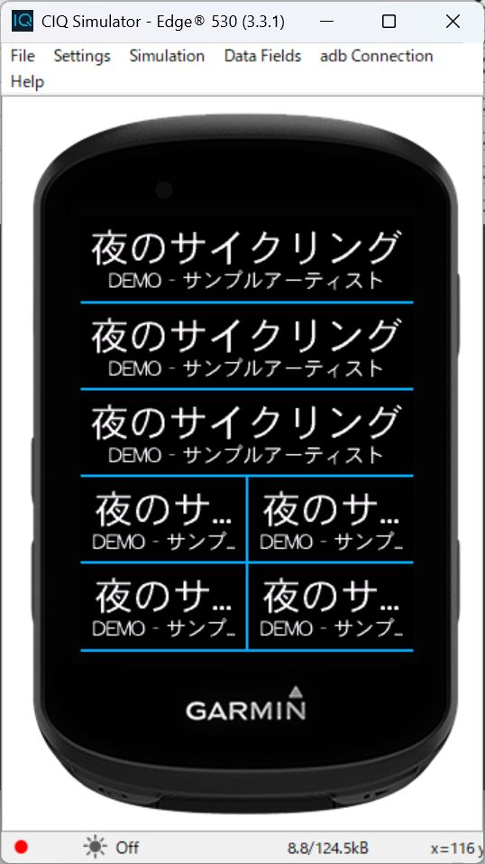

# Garmin Now Playing Data Field

Garmin Edge 530 の走行データ画面に、iPhone で再生中の曲名・アーティスト名を表示するためのプロジェクト。Spotify と Apple Music の両方を対象にする。

**表示デモは動作確認済み。次は iPhone アプリ経由で取得・転送する方式を Mac で検証します。実際の再生情報はまだ取得できません。**

## 続きから開発する場合

最初に [引き継ぎメモ](docs/HANDOFF.md) と [iPhone アプリの調査・検証計画](docs/ios-companion-plan.md) を読むこと。
最新のユーザー決定は **iPhone アプリ経由で進め、続きは Mac で行う**こと。
Apple Music と Spotify から別々の API で情報を取得し、Garmin iOS Mobile SDK で転送する構成を最初に試す。
iOS アプリはまだ未作成。前面での取得・転送と、ロック中の継続動作を分けて実機検証する。

Garmin 側の開発は Windows・macOS・Linux で行える。今回採用した iPhone アプリのビルド・実機署名には **macOS / Xcode が必要**。
Mac で再開する場合は [macOS セットアップ](docs/setup-macos.md) を参照。

Edge 530 から AMS への直接接続は [公開 API の調査](docs/ams-feasibility.md)により見送った。この判断は iPhone アプリ経由まで否定するものではない。

## 現在できること

`Now Playing Demo` という Data Field を Edge 530 向けに定義しています。
15秒ごとに、短い曲名・長い曲名・日本語・一時停止・未再生のダミー表示を切り替えます。
2行に収まらない高さでは1行表示に切り替えます。画面の明暗に合わせて文字色も切り替えます。
サンプルのアーティスト行には `DEMO` を付けています。
`Demo sample` でサンプルを固定する設定定義と処理も実装しています（初期値は自動切替）。
今回の SDK 設定エディターでは設定 JSON の読み込みエラーが出ており、設定画面からの変更は未確認です。
日本語サンプルは、シミュレーターの言語設定を Japanese にして表示確認しました。

AMS 接続・再生情報の実取得・iPhone アプリ・Bluetooth 通信はまだ実装していません。
端末側の権限もまだ要求しません。



## 開発環境（Windows）

1. [Garmin 公式 SDK](https://developer.garmin.com/connect-iq/sdk/) と Java ランタイムを用意します。
2. SDK Manager に **普段の Garmin Connect アカウント** でログインし、Edge 530 のデバイス定義をダウンロードします。
3. `CIQ_SDK_HOME` に SDK 本体のディレクトリを設定します（`bin` の親）。Java を `PATH` に追加します。
4. 署名鍵を生成し、ビルドします。鍵生成には Node.js が必要です。

```powershell
$env:CIQ_SDK_HOME = 'C:\path\to\connectiq-sdk'
node scripts/generate-key.mjs
.\scripts\build.ps1
```

鍵は `.local/developer_key.der` に生成し、既存の鍵は上書きしません。
既存の開発者鍵を使う場合は `CIQ_DEVELOPER_KEY` または `-KeyPath` で指定できます。
SDK Manager のアクティブ SDK 設定があれば、`CIQ_SDK_HOME` は省略できます。

この作業フォルダで用意した環境を再利用する場合は、Git 管理外の `.local/dev-env.ps1` を読み込みます。

```powershell
. .\.local\dev-env.ps1
.\scripts\build.ps1
```

## シミュレーターとテスト

SDK の `bin\simulator.exe` を起動してから、次を実行します。

```powershell
& "$env:CIQ_SDK_HOME\bin\monkeydo.bat" (Resolve-Path bin/nowplaying.prg).Path edge530
```

Data Fields の表示設定で枠を変え、[確認手順](docs/validation.md)に沿って表示を調べます。
Monkey C のテストビルド・実行は次のとおりです。

```powershell
.\scripts\build.ps1 -TestBuild
& "$env:CIQ_SDK_HOME\bin\monkeydo.bat" (Resolve-Path bin/nowplaying-tests.prg).Path edge530 /t
```

テストはデモの切替境界と、実際のフォント寸法を使う文字省略を対象にします。
スクリーン表示や通信の動作確認は別に必要です。
現在の結果は Edge 530 / API 3.3.1 で3件 PASS。横長246×63pxの2行表示、長い曲名の省略、日本語、白黒背景をシミュレーターで確認済みです。

## 構成

| パス | 役割 |
| --- | --- |
| `source/NowPlayingView.mc` | 枠の寸法に応じた描画 |
| `source/DemoSource.mc` | 個人の履歴を使わないダミー情報 |
| `source/TextFit.mc` | フォント幅を測って末尾を省略 |
| `tests/` | Monkey C のテスト |
| `docs/transport-research.md` | 通信制約と次の検証 |
| `docs/ios-companion-plan.md` | iPhone 方式の調査結果・Mac で試す順序・合格条件 |
| `docs/ams-feasibility.md` | AMS 直接接続の判断・根拠・再開条件 |
| `research/ams/` | API 監査・コンパイルプローブ・保存した結果 |
| `docs/validation.md` | 実行済みチェックと実機確認の手順 |
| `docs/HANDOFF.md` | 方針・現在地・次の作業・別マシンへの引き継ぎ |
| `docs/setup-macos.md` | Mac での環境準備とビルド・テスト手順 |

## 最初の目標

- Connect IQ / Monkey C の Data Field として実装する。
- 横幅いっぱいの1枠に曲名を大きく、アーティスト名を小さく表示する。
- 長い文字列は枠の幅に合わせて省略する。
- ジャケット画像、再生操作、Spotify Like は初期実装に含めない。

## 実装順

1. ダミー曲の2行表示と Edge 530 向けビルド。
2. シミュレーターと実機でデータ画面の分割・寸法・日本語表示を確認。
3. AMS 直接接続の制約調査は完了。現行公開 API では実装を見送る。再開には具体的な対応経路の根拠が必要。
4. iPhone アプリ方式を採用。Mac で Apple Music / Spotify の前面取得と、合成データの Garmin 転送を別々に確認してから組み合わせる。
5. 両サービスで iPhone ロック中の自然な曲変更・切断復帰を実機評価する。前面で動くだけで完成と扱わない。追加機器は採用していない。

## 設計元

[garmin-nowplaying-datafield（Cosense）](https://scrapbox.io/kouki/garmin-nowplaying-datafield)

公開リポジトリにはソースと開発手順のみを置きます。署名鍵、Spotify のトークン、ローカル SDK、個人の再生履歴は Git 管理から除外します。
