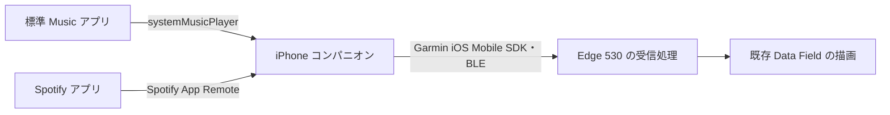

# iPhone アプリ経由の調査と Mac での検証計画

更新日: 2026-10-24。**ユーザーは iPhone アプリ経由で進め、続きは Mac で行うと決定した。**
Apple Music と Spotify の両方を対象とする。追加 BLE 機器は導入しない。
アプリの起動・権限許可・初期接続は許容する。走行中に iPhone をロックできることは引き続き目標であり、前面表示し続ける条件へ変更したわけではない。

## 現在の結論と未検証の範囲

Edge 530 から AMS へ直接接続する方式は [公開 API の制約調査](ams-feasibility.md)により見送った。
この判断は、**iPhone アプリがサービス別に情報を取得し、Garmin に転送する方式まで否定するものではない**。

今回確認したのは公式資料上の取得・転送経路。iOS アプリのプロジェクト、署名、実機ビルド、音楽の実取得、Garmin への実転送はいずれもまだ行っていない。
Mac に移ったら、以下の小さな実験を順に実装する。既存の表示デモは基準として残す。

## 取得と転送を分けた構成

これは最初に試す構成。全体の動作を確認した構成ではない。
最初はコンパニオンで Apple Music / Spotify を手動選択し、自動判別は後回しにする。
Apple Music 側に残る以前の曲を、Spotify 再生中の情報として送らない。

## 公式資料から確認したこと

| 項目 | 資料上の事実 | Mac で確認すること |
| --- | --- | --- |
| Apple Music | [`MPMusicPlayerController.systemMusicPlayer`](https://developer.apple.com/documentation/mediaplayer/mpmusicplayercontroller/systemmusicplayer) は標準 Music アプリの状態、Now Playing item、再生状態を共有する | ユーザーの iPhone・OS・通常の Apple Music 再生で title / artist / playbackState を実際に読めるか |
| 曲変更通知 | [`beginGeneratingPlaybackNotifications()`](https://developer.apple.com/documentation/mediaplayer/mpmusicplayercontroller/begingeneratingplaybacknotifications()) と曲変更・再生状態変更の通知がある | 前面とバックグラウンドでの通知到達。通知登録がアプリの常時実行権を与えるとは解釈しない |
| 共通 Now Playing | [`MPNowPlayingInfoCenter`](https://developer.apple.com/documentation/mediaplayer/mpnowplayinginfocenter) は自分のアプリが再生する情報をシステムへ提供するための API | 他アプリ横断の読み出し口として実装しない。Apple Music / Spotify の取得処理を分ける |
| Spotify | [公式 iOS SDK](https://github.com/spotify/ios-sdk) は認証、再生中メタデータ、player state の購読を提供する | 認証と App Remote 接続、前面での曲変更。対象アカウント・開発アプリの利用条件も導入時に確認 |
| Spotify のライフサイクル | [公式ガイド](https://developer.spotify.com/documentation/ios/concepts/application-lifecycle) は非アクティブ時の切断と再アクティブ時の再接続を推奨する | ロック中の継続購読は保証されていない。Spotify アプリが裏で再生できることと、自作アプリが動き続けることを区別 |
| Garmin 転送 | [Garmin iOS Mobile SDK](https://github.com/garmin/connectiq-companion-app-sdk-ios/blob/main/documentation/ConnectIQ_iOS_SDK.html) は Garmin Connect Mobile（GCM）で端末を選び、その後 BLE でアプリの mailbox へ送信する | Edge 530 上の Data Field 実行中に受信・描画できるか。SDK の送信完了だけで表示成功にしない |
| iOS バックグラウンド | [Core Bluetooth の説明](https://developer.apple.com/library/archive/documentation/NetworkingInternetWeb/Conceptual/CoreBluetooth_concepts/CoreBluetoothBackgroundProcessingForIOSApps/PerformingTasksWhileYourAppIsInTheBackground.html)と Garmin SDK は Bluetooth イベントによる復帰を説明する | 曲変更そのものが復帰理由になるとは仮定しない。取得・送信のどちらが止まったかログで分ける |

`systemMusicPlayer` の対象は標準 Music アプリであり、Spotify の曲を同じ API から読む計画ではない。
標準 Music の再生継続も、コンパニオンの実行継続を保証しない。
`nowPlayingItem == nil`、権限拒否、メタデータ欠落を正常な状態として扱う。

## Mac で最初に準備するもの

1. [Mac セットアップ](setup-macos.md)に沿って clone し、既存の Monkey C デモをビルドできる状態にする。
2. Mac と接続できる iPhone、Edge 530、USB ケーブルを用意する。macOS / Xcode / iOS のバージョンと署名方法を記録する。
3. Xcode で最小の Swift / SwiftUI アプリを同じリポジトリの `ios/` に新規作成する。まだこのディレクトリや `.xcodeproj` は存在しない。まず空アプリを iPhone 実機で起動する。
4. Apple Music の読み取りに必要な説明文・認可を現在の SDK に合わせて設定し、[`MPMediaLibrary.requestAuthorization`](https://developer.apple.com/documentation/mediaplayer/mpmedialibrary/requestauthorization(_:))等で許可結果を扱う。Bluetooth の許可、SDK の callback URL scheme、Garmin Connect Mobile の端末選択は導入する SDK の手順に従う。
5. Spotify SDK を入れる段階で Spotify 開発アプリの client ID、Bundle ID、redirect URI を揃える。[公式の導入手順](https://developer.spotify.com/documentation/ios/getting-started)を確認する。認証は本人が行う。

Xcode の共有プロジェクト設定は Git 管理するが、署名の個人設定・provisioning profile・秘密鍵・アクセストークン・SDK バイナリはコミットしない。
採用した依存バージョンと導入方法を記録し、トークンは Keychain 等で保管する。公開アプリに client secret を埋め込まない。
ログに個人の曲名・端末 ID・アカウント・認証情報を含めたまま公開しない。

## 実験の順序と合格条件

### 1. iPhone 前面で Apple Music の情報を読む

標準 Music アプリで再生してからコンパニオンへ戻り、読み取り専用で `systemMusicPlayer.nowPlayingItem` の title / artist と再生状態を表示する。
曲変更・一時停止・再開・未再生について通知と再読み取りを記録する。再生キューの設定や曲の強制再生は行わない。
ライブラリ内の曲とストリーミング曲で確認し、取得できない場合は曲の種類・許可・nil の状態を記録する。

合格: 操作前後の実際の曲と画面が一致し、古い値や nil を区別できる。ここではロック中対応とはしない。

### 2. iPhone 前面で Spotify の情報を読む

公式サンプルを参考に認証・App Remote 接続・player state 購読を最小実装する。
再生中に接続し、曲名・アーティスト・一時停止を表示する。認証やアプリ復帰による再生への影響も記録する。

合格: 前面で曲変更に追従し、切断時は明示的に未接続となる。Apple Music の前の曲を混ぜない。

### 3. 音楽を使わず iPhone → Edge 530 の転送を確かめる

Garmin iOS Mobile SDK を最初の転送候補とする。GCM で Edge 530 を選択し、既存アプリ ID `0e7452a432a14e80baf47e5fe3f0a6d1` と送信先を揃える。
連番と合成 title / artist をボタンで送る。ソースを差し替えられるようにし、現行デモの動作も残す。

Edge 530 の foreground Data Field で Communications を直接使う前提にしない（foreground Data Field 対応は API 5.0 以降）。
まず [`Background.registerForPhoneAppMessageEvent()`](https://developer.garmin.com/connect-iq/api-docs/Toybox/Background.html#registerForPhoneAppMessageEvent-instance_function) による受信を小さく試す。
API 3.2 からの対象機種に Edge 530 がある。必要な Background / Communications 権限・ServiceDelegate・登録を SDK で照合し、メッセージ受信 → `Background.exit(data)` → `AppBase.onBackgroundData(data)` → 描画まで確認する。
これは実装候補で、まだ機種指定ビルドも実機動作も確認していない。時間イベントの5分間隔と Phone App Message イベントを混同しない。

合格: 送信した合成メッセージの連番・日本語が、走行データページを表示したまま Edge の画面に反映される。受信・描画時刻、メモリ、欠落を記録する。

### 4. 前面の取得と転送をつなぐ

Apple Music と Spotify を手動選択し、それぞれの曲変更を Edge へ送る。
候補データは version、session ID、連番、source、title、artist、playback state、取得時刻。転送形式・上限は SDK と実機の結果で決める。
最新状態だけを保持し、再接続後に古いキューで表示を巻き戻さない。送信過多を抑え、通信断・情報の期限切れを表示上区別する。

合格: 両サービスで前面の取得・受信・描画が一貫し、取得失敗と転送失敗を切り分けられる。

### 5. iPhone ロック中の継続を最優先で実機評価する

UI を作り込む前に、Garmin SDK の Bluetooth background mode と state restoration を公式手順に沿って設定する。
音楽アプリとコンパニオンを区別し、次の表の各サービスを個別に試す。

| 条件 | 観測すること | 現在 |
| --- | --- | --- |
| コンパニオン前面 | 手動スキップ、自然な曲の終了、一時停止・再開 | 未実施 |
| 他アプリへ切替後、画面点灯 | 取得通知と送信の継続、切断の有無 | 未実施 |
| ロックして15〜30分 | 複数曲の自然な切替、ロック画面での操作、iOS がアプリを休止した後の更新 | 未実施 |
| Apple Music ⇔ Spotify 切替 | 再接続、source の選択、古い曲を表示しないか | 未実施 |
| Bluetooth 切断・復帰 | 接続状態、最新曲への復帰、要手動操作か | 未実施 |
| 低電力モード、コンパニオンの強制終了 | 停止条件と回復操作。通常のバックグラウンド試験とは分けて記録 | 未実施 |

測定項目は、曲変更時刻、取得 callback 時刻、iPhone の状態、SDK 接続状態、送信結果、Edge の受信・表示時刻、連番、電池残量とする。
上記時間は最初の実験条件であり、15〜30分通っただけで長時間走行に対応したとはしない。

ロック中に止まったら、取得停止・SDK 切断・Edge 側未受信・描画停止を分けて原因を調べる。
前面へ戻したときだけ更新される場合は、その条件を結果として明記する。無音再生等で常時実行を装う方法は採用しない。
Spotify Web API は別候補だが、ネット接続・認証・ポーリング・iOS の起動条件を別途評価する必要があり、勝手に切り替えない。

## 転送経路の予備案と判断

独自 Core Bluetooth GATT service を iPhone peripheral / Edge central で提供する案は予備に留める。
iOS のバックグラウンド広告ではローカル名が省かれ、service UUID は iOS 専用の overflow 領域へ移る制約があるため、Edge からの再発見を保証できない。
Garmin SDK が使えなかった場合にだけ、初回接続とロック後の維持・再接続を分けて検証する。

Apple Music と Spotify の両方でロック中更新が成立してから、本実装へ進む。
成立しなければ前面起動が必要な範囲と失敗箇所を報告し、利用条件をユーザーと決める。追加機器や片方のサービスだけへの変更を既定にしない。

## 次回記録する欄

現時点ではすべて未実施。実行後はこの節またはリンクした別の結果ファイルに追記し、[validation.md](validation.md)と [HANDOFF.md](HANDOFF.md)も更新する。

| 項目 | 記録 |
| --- | --- |
| 実施日 / コミット / 実験番号 | 未実施 |
| Mac / Xcode / iPhone・iOS / Edge firmware | 未実施 |
| Garmin SDK / Spotify SDK のバージョン | 未実施 |
| 対象サービス・曲の種類・権限状態 | 未実施 |
| 前面 / 他アプリ / ロックの結果と遅延 | 未実施 |
| 復帰に必要だった操作・失敗の再現手順 | 未実施 |
